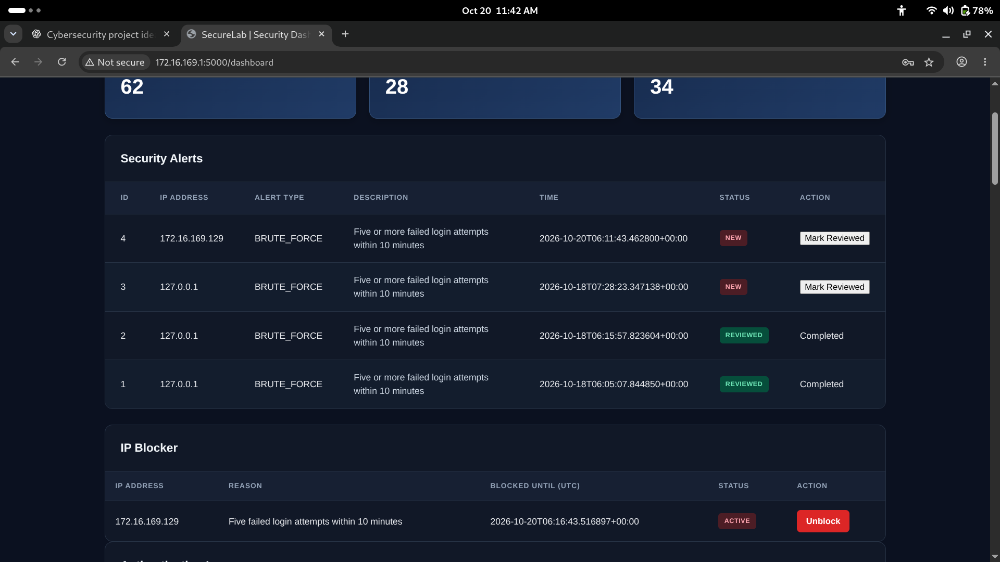
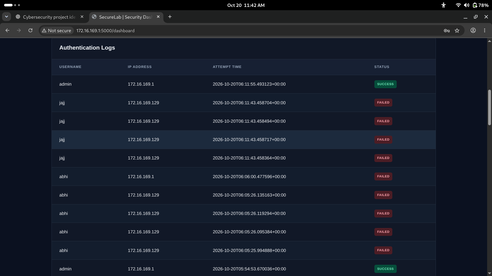
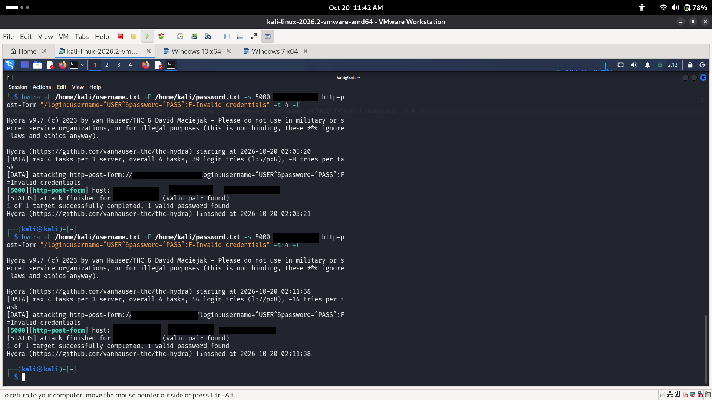
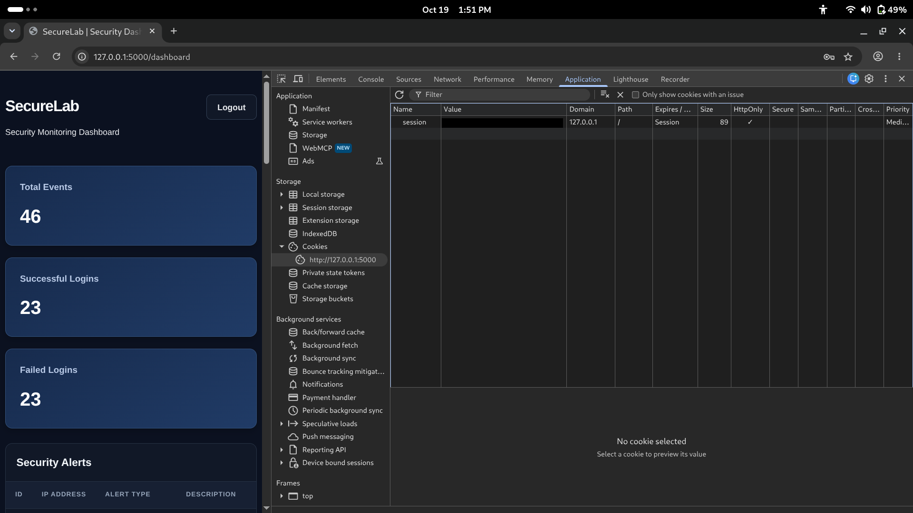

# SecureLab — Authentication Attack & Defense Lab

SecureLab is an educational Flask-based cybersecurity project that demonstrates authentication security, login monitoring, attack detection, and defensive controls using Python and SQLite.

The project provides a controlled environment for exploring authentication attacks and understanding how defensive mechanisms detect and respond to suspicious login activity.

## Features

- **Password Security:** Stores password hashes using Werkzeug.
- **Authentication Logging:** Records successful and failed login attempts.
- **Brute-Force Detection:** Detects repeated failed login attempts from a single IP address.
- **Password-Spraying Detection:** Detects failed authentication attempts across multiple usernames.
- **Temporary IP Blocking:** Blocks suspicious IP addresses for a configured period.
- **Automatic Block Expiry:** Allows an IP to become eligible for access again after its block expires.
- **Security Alerts:** Generates alerts for suspected brute-force and password-spraying activity.
- **Admin Dashboard:** Displays authentication logs, alerts, blocked IPs, and login statistics.
- **Failed-Login Activity Chart:** Visualizes failed login activity over a 24-hour period.
- **IP Investigation:** Shows authentication history, related alerts, activity summaries, and current block status for an IP address.
- **Role-Based Access Control (RBAC):** Restricts administrative features to authorized administrators.
- **Alert Review and IP Management:** Supports reviewing alerts and managing IP blocks.
- **Session Security:** Uses Flask sessions with a configured session lifetime and cookie settings.
- **CSRF Protection:** Uses Flask-WTF to protect state-changing requests.

## Project Screenshots

### Brute-Force Detection


### Failed Login Attempts


### Hydra Attack Demonstration


### Session Cookie Security


## How Detection Works

SecureLab monitors failed authentication attempts and identifies suspicious login activity using time-based detection rules.

### 1. Brute-Force Detection
- Monitors failed login attempts from an IP address.
- Triggers a brute-force alert when 5 or more failed attempts occur within 10 minutes.
- Temporarily blocks the IP address for 5 minutes.

### 2. Password-Spraying Detection
- Monitors failed login attempts across different usernames from the same IP address.
- Triggers a password-spraying alert when at least 5 failed attempts target at least 5 distinct usernames within 10 minutes.

### Detection Workflow

1. A user submits a login attempt.
2. The application records the authentication event.
3. Detection functions analyze recent failed attempts.
4. Suspicious activity generates a security alert.
5. The application temporarily blocks the IP when the brute-force threshold is reached.
6. The admin dashboard displays security activity and alerts.

### Detection Flow

Login Attempt
     |
     v
Authentication Event Logged
     |
     v
Detection Rules Evaluated
     |
     +----------------------+
     |                      |
     v                      v
Normal Activity       Suspicious Activity
                            |
                            v
                      Security Alert
                            |
                            v
                   Temporary IP Block
                            |
                            v
                    Admin Dashboard

## Test Results

SecureLab was tested locally using Flask's test client and SQLite test databases.

| Test | Expected Result | Result |
|---|---|---|
| Existing user with incorrect password | Login rejected | PASS |
| Unknown username | Login rejected with generic error | PASS |
| Missing credentials | Generic validation error | PASS |
| Brute-force threshold | IP not blocked after 4 failures; blocked after 5 | PASS |
| Brute-force alert | Alert created | PASS |
| Duplicate brute-force alert | Duplicate alert prevented | PASS |
| Blocked IP login | Login rejected | PASS |
| Expired IP block | Block becomes inactive | PASS |
| Expired block cleanup | Database entry removed | PASS |
| Password spraying | Alert generated for 5 usernames and 5 failed attempts | PASS |
| Repeated username | No password-spraying alert generated | PASS |
| Database cleanup | Connection closes after commit/insert failures | PASS |

**Test files:**
- `test_login_timing.py`
- `test_db_cleanup.py`

These results represent local lab testing and do not establish production security.

## Security Design Choices

| Security Control | Implementation |
|---|---|
| Password Storage | Passwords are stored using Werkzeug password hashing rather than plaintext. |
| CSRF Protection | Flask-WTF protects form submissions against cross-site request forgery. |
| SQL Injection Prevention | Parameterized SQL queries are used for database operations. |
| Authentication Errors | Generic login errors avoid revealing whether a username exists. |
| Session Security | Flask session lifetime and cookie settings are configured. |
| Access Control | Role-based access control separates admin and regular-user access. |
| Attack Monitoring | Failed authentication attempts are logged and analyzed for suspicious activity. |

## Why I Built This

I built SecureLab to understand how authentication attacks work and how applications can detect and respond to suspicious login activity. The project helped me apply Python, Flask, SQL, and basic security concepts in a practical environment.

## Project Roadmap

### Completed
- [x] User authentication with password hashing
- [x] Brute-force detection
- [x] Password-spraying detection
- [x] Temporary IP blocking
- [x] Authentication logging
- [x] Security alerts
- [x] Admin dashboard
- [x] CSRF protection
- [x] Role-based access control
- [x] Failed-login activity chart

### Planned
- [ ] Successful-login anomaly detection
- [ ] Exportable security reports
- [ ] More automated security test cases
- [ ] Improved dashboard analytics

## Technology Stack

- Python
- Flask
- SQLite
- Werkzeug
- Flask-WTF
- WTForms
- python-dotenv
- HTML and CSS

## Project Structure

```text
securelab-auth-threat-detection/
├── app.py
├── init_db.py
├── create_user.py
├── test_db_cleanup.py
├── test_login_timing.py
├── requirements.txt
├── README.md
├── .env.example
├── templates/
├── static/
└── evidence/
```

## Getting Started

Follow these steps to set up SecureLab locally.

### 1. Clone the repository

```bash
git clone https://github.com/abhiveer-lab/securelab-auth-threat-detection.git
cd securelab-auth-threat-detection
```

### 2. Create a virtual environment

```bash
python3 -m venv .venv
source .venv/bin/activate
```

### 3. Install dependencies

```bash
pip install -r requirements.txt
```

### 4. Configure environment variables

Copy the example environment file:

```bash
cp .env.example .env
```

Generate a unique secret key:

```bash
python -c "import secrets; print(secrets.token_hex(32))"
```

Open `.env` and replace the placeholder with your generated key:

```text
FLASK_SECRET_KEY=your_generated_secret_key
```

Keep the actual `.env` file private. Never commit your real secret key to GitHub. The `.env.example` file should contain only a placeholder, not a real secret.

### 5. Initialize the database

```bash
python init_db.py
```

This initializes the SQLite database schema required by the application. Run it before creating users or starting SecureLab.

If you are working with an existing database, back it up before making schema changes. The initialization script uses `CREATE TABLE IF NOT EXISTS`; it does not automatically migrate existing tables to a newer schema.

### 6. Create a user

```bash
python create_user.py
```

Follow the prompts to:

1. Enter a username.
2. Select a role: `user` or `admin`.
3. Enter a password of at least 12 characters.
4. Confirm the password.

The script hashes the password before storing it in the database and rejects duplicate usernames.

Only trusted operators should run this local script. Do not expose it as a web route. Create an administrator account when required to access the admin dashboard.

### 7. Run SecureLab

```bash
python app.py
```

Open the application in your browser:

http://127.0.0.1:5000

Log in using the account you created in Step 6.

For local virtual-machine testing, configure networking and the Flask listening address as required. Do not expose the Flask development server to untrusted networks.

## Security Testing

Test only your own lab or systems for which you have explicit authorization.

Suggested tests include:

- Valid and invalid login attempts.
- Generic error responses for rejected login attempts.
- Admin-page access restrictions for logged-out users and regular users.
- Brute-force detection, alert generation, and temporary IP blocking.
- Automatic IP-block expiry.
- Password-spraying detection across multiple test accounts.
- IP attribution, authentication logs, and investigation details.
- CSRF rejection for requests missing a valid token.
- Session timeout and logout behavior.
- Database query parameterization and secret management.

The repository includes the following test scripts:

```bash
python -m unittest test_db_cleanup -v
python test_login_timing.py
```

Record the test setup, expected behavior, observed results, and screenshots as evidence. Run the tests in an appropriate test environment and review their output before drawing conclusions about the application's security.

## Limitations

SecureLab is an educational project, not a production-ready security product.

Its detection rules are simplified and may produce false positives or false negatives. Production deployment would require additional security review, comprehensive automated testing, HTTPS configuration, secure cookie settings, robust logging, operational monitoring, database migration management, and deployment hardening.

The Flask development server is intended for local development and testing, not production deployment.

## Future Improvements

- Improve detection accuracy and reduce false positives.
- Add configurable detection thresholds.
- Introduce admin audit logging for security-sensitive actions.
- Improve deployment configuration and security hardening.
- Expand automated regression testing.
- Improve documentation of attack simulations and defensive responses.

## Author

**Abhiveer**

- GitHub: [abhiveer-lab](https://github.com/abhiveer-lab)
- LinkedIn: [Abhiveer Vashisht](https://www.linkedin.com/in/abhiveer-vashisht-680206313/)

BCA graduate interested in cybersecurity, currently building practical skills in security analysis, penetration testing, Linux, and Python.

**Currently seeking cybersecurity internship opportunities.**
